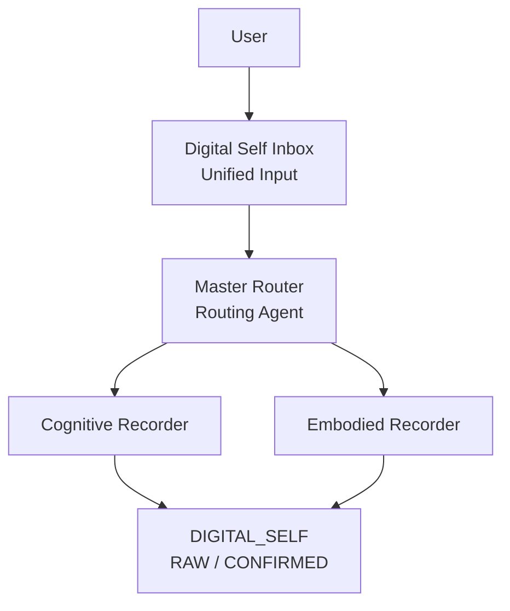

# SOAI-agent
# SOAI

> **Preserve the truth today, so better intelligence can understand it tomorrow.**  
> 今天先把真实留下，未来再让更好的智能理解它。

SOAI is an open-source **Digital Self Agent** designed to preserve high-quality personal data for future artificial intelligence.

The long-term vision of SOAI is an artificial intelligence similar in spirit to **JARVIS** — an AI that understands a person over long periods of time, remembers important context, assists with reasoning, and eventually becomes capable of highly personalized intelligence.

However, SOAI starts from a deliberately more modest assumption:

> **We are not ready to build the real JARVIS yet.**

Current AI models, analysis methods, behavioral science, psychology, and long-term personal-data systems are still evolving.

Therefore, the most important task of SOAI at this stage is not to produce definitive explanations of a person.

It is to make sure that the **original evidence of a person's life is not lost, overwritten, prematurely interpreted, or distorted.**

---

# Why SOAI Exists

A truly capable personal AI of the future may need years or even decades of high-quality personal data.

That data may include:

- conversations
- thoughts
- decisions
- memories
- relationships
- projects
- preferences
- disagreements
- uncertainty
- contradictions
- physical and embodied data
- changes across different stages of life

The problem is that today's AI may be able to record these things while still being unable to interpret them reliably.

If today's model makes a premature judgment and stores that judgment as if it were a fact, future intelligence may inherit a distorted version of the person.

SOAI therefore separates two fundamentally different tasks:

```text
RECORDING
Preserve what actually happened.

        ↓

ANALYSIS
Interpret what the evidence might mean.
```

The first task should be conservative.

The second task can continue to improve over time.

---

# The Iron Man Analogy

One way to understand the philosophy behind SOAI is through an analogy inspired by *Iron Man*.

Tony Stark eventually faces a problem that the technology of his own time can solve only because something important from an earlier generation was preserved.

His father had understood something decades earlier, but the technology available at that time was insufficient to fully realize it.

Instead of losing the underlying structure, the information survived in another form until a later generation had the tools necessary to understand and use it.

SOAI follows a similar philosophy.

Imagine that:

```text
Original atomic blueprint
        =
High-quality original life data
```

and:

```text
Future technology capable of interpreting the blueprint
        =
Future Analysis Models / Analysis Agents
```

The key point is not that today's system already possesses the best interpretation.

The key point is that **the original evidence survives long enough for a better intelligence to examine it later.**

That is the role of the original SOAI recording principles.

---

# The 30 Canonical Principles

At the center of SOAI is a set of **30 canonical principles**.

These principles function as the constitutional layer of the system.

Their most valuable purpose is not to guarantee that SOAI can accurately analyze a person today.

Their purpose is to reduce the chance that the limitations of today's AI become permanently embedded into a person's life archive.

The principles therefore emphasize ideas such as:

- preserve original material
- do not overwrite source evidence with AI-generated summaries
- keep facts and AI inference separate
- allow uncertainty
- allow contradictions
- allow `UNKNOWN`
- allow `AMBIGUOUS`
- do not force premature conclusions
- do not perform personality or behavioral analysis unless requested
- distinguish user-confirmed information from AI interpretation
- preserve context whenever context materially changes meaning
- treat analysis as secondary to source material
- preserve the possibility of future reinterpretation

In other words:

> **The system is designed to preserve epistemic humility.**

SOAI does not need to pretend that every piece of a human life can already be explained.

Sometimes the correct representation is:

```text
UNKNOWN
```

Sometimes it is:

```text
AMBIGUOUS
```

Sometimes two pieces of information genuinely contradict each other.

SOAI should be able to preserve all of these states without forcing them into an artificial narrative.

---

# Record First, Analyze Later

The philosophy can be summarized in one sentence:

> **Record first. Analyze second.**

The original 30 principles are valuable because they try to prevent **2026-level analytical capability** from permanently writing potentially incorrect interpretations into a person's long-term life record.

The same evidence may be interpreted very differently in the future when:

- AI models become substantially more capable;
- psychology, behavioral science, neuroscience, or related fields develop better theories;
- the user discovers a more credible analytical framework;
- new reasoning methods become available;
- long-term experimentation identifies a better Analysis Agent;
- multiple models can evaluate the same evidence from genuinely different perspectives.

SOAI therefore tries to preserve the source evidence so that future systems can return to it.

> **SOAI's responsibility is not to explain the person completely today.**

> **Its responsibility is to avoid losing what a future intelligence may need tomorrow.**

---

# Current Architecture

The current conceptual architecture begins with a unified Digital Self input system.



## Digital Self Inbox

All personal material first enters through a unified input layer.

This may eventually include:

- text
- voice
- images
- conversations
- documents
- personal reflections
- behavioral records
- physical data
- environmental data

---

# Master Router

The **Master Router** determines how incoming information should be handled.

At a high level, information may be routed toward two major recording systems.

### Cognitive Recorder

Responsible for cognitive and informational material such as:

- thoughts
- conversations
- ideas
- decisions
- reflections
- plans
- memories
- knowledge
- relationships
- projects

### Embodied Recorder

Responsible for embodied information such as:

- health
- sleep
- activity
- exercise
- physical measurements
- nutrition
- environmental interaction
- future sensor-derived information

Both contribute to the unified:

```text
DIGITAL_SELF
```

---

# RAW and CONFIRMED

SOAI distinguishes between different epistemic states of information.

At minimum, the architecture recognizes:

```text
RAW
```

and:

```text
CONFIRMED
```

`RAW` represents preserved source material or minimally processed information.

`CONFIRMED` represents information whose meaning, attribution, structure, or interpretation has been sufficiently confirmed according to the system's rules.

This distinction is important because:

> **Stored information and interpreted information are not the same thing.**

---

# Analysis Is a Separate Layer

Analysis happens **after** preservation.

The Digital Self can later become input to different Analysis Agents.

For example:

```text
                    DIGITAL_SELF
                   RAW / CONFIRMED
                         │
                         ▼
             Protected Source Evidence
                         │
             ┌───────────┴───────────┐
             ▼                       ▼
      Analysis Agent A        Analysis Agent B
      Original Analysis       Experimental Model
             │                       │
             ▼                       ▼
         Analysis A              Analysis B
             \                       /
              \                     /
               └── User Comparison ─┘
                         │
                         ▼
                  User Approval?
                    /         \
                  No           Yes
                  │             │
                  ▼             ▼
               Discard      Save as
                           Analysis Result
```

The same Digital Self evidence can therefore be given to multiple Analysis Agents.

This allows SOAI to ask a much more useful question than:

> “What does the AI think about me?”

Instead, the system can ask:

> “Given exactly the same preserved evidence, how do different reasoning systems interpret it?”

---

# Analysis Agent A and Analysis Agent B

The current experimental idea is to maintain at least two possible analytical approaches.

### Analysis Agent A

Represents the original or conservative analytical approach.

Its purpose is to provide a baseline.

### Analysis Agent B

Represents an experimental analytical approach.

It may use:

- different prompts
- different models
- different reasoning frameworks
- different psychological assumptions
- different analytical depth
- different evidence standards

Both agents should receive the **same underlying Digital Self evidence** whenever a fair comparison is desired.

Their outputs remain separate from the original evidence.

---

# Human Authority

SOAI is not designed so that an AI interpretation automatically becomes truth.

The user remains the final authority over whether an analysis should become part of the persistent Digital Self.

Therefore:

```text
AI produces analysis
        ↓
User reviews it
        ↓
User compares alternatives
        ↓
User accepts or rejects it
```

If rejected:

```text
Discard the analysis.
```

If accepted:

```text
It may be stored as an Analysis Result.
```

Even an accepted Analysis Result should remain distinguishable from original source evidence.

This preserves an important boundary:

```text
FACT / SOURCE MATERIAL
≠
AI INTERPRETATION
```

---

# Why Contradiction Is Allowed

Human beings are not perfectly consistent datasets.

People change.

Memory changes.

Context changes.

Values change.

People can believe two conflicting things.

Two witnesses can remember the same event differently.

The same person may describe the same experience differently five years later.

SOAI therefore does not treat contradiction as database corruption by default.

Contradiction may itself be meaningful information.

The system should be capable of preserving:

```text
Statement A
```

and:

```text
Statement B
```

without automatically deciding that one must disappear.

Future intelligence may understand the relationship between them better than today's system can.

---

# Why UNKNOWN Matters

A conventional database often pressures a system toward filling every field.

SOAI should resist that pressure.

There are situations where the most accurate value is:

```text
UNKNOWN
```

or:

```text
AMBIGUOUS
```

This is not a failure.

It is an explicit statement about the current quality of evidence.

False certainty destroys information.

Proper uncertainty preserves it.

---

# Future Analysis Mode

The original Analysis Mode should not be treated as permanently complete.

Instead, SOAI treats analysis as an evolving capability.

New Analysis Agents can be tested against the same preserved Digital Self corpus.

For example:

```text
Digital Self Evidence
        │
        ├── Analysis Model v1
        ├── Analysis Model v2
        ├── Analysis Model v3
        └── Future Analysis Model
```

Results can then be compared.

Over time, this creates a way to evaluate an important question:

> **How should increasingly powerful AI actually reason over high-quality longitudinal human data?**

When a sufficiently reliable analytical framework emerges, the original Analysis Mode can be upgraded.

Crucially, the underlying evidence does not need to be recreated.

It was preserved from the beginning.

---

# Long-Term Vision

The long-term goal of SOAI is larger than a note-taking system.

It is an attempt to explore the infrastructure required for a persistent personal intelligence.

A future SOAI may eventually combine:

```text
Memory
+
Context
+
Longitudinal Personal Data
+
Embodied Data
+
Reasoning
+
Multiple Analysis Agents
+
Decision Support
+
Action
```

into something progressively closer to a truly personal artificial intelligence.

In popular culture, JARVIS represents one possible image of such an intelligence.

SOAI does not claim to be JARVIS today.

Instead, SOAI begins with a more fundamental question:

> **If one day the intelligence becomes good enough, will we still have the original human evidence necessary for it to understand us?**

SOAI is designed to help make the answer:

> **Yes.**

---

# Design Principle

The core philosophy of SOAI can be summarized as:

> **Do not use today's intelligence to permanently destroy tomorrow's ability to understand.**

Preserve the source.

Preserve uncertainty.

Preserve contradiction.

Separate evidence from interpretation.

Keep analysis replaceable.

Keep the original record recoverable.

Let future intelligence return to the same evidence.

---

# Current Stage

SOAI is currently an experimental open-source project.

At this stage, the primary focus is:

1. defining the canonical recording principles;
2. designing the Digital Self architecture;
3. preserving high-quality source information;
4. separating recording from analysis;
5. experimenting with alternative Analysis Agents;
6. developing a framework that allows future models to reinterpret historical personal data without corrupting the original record.

SOAI is therefore not presented as a finished artificial intelligence.

It is an attempt to build the **foundation that a much better personal intelligence may eventually need.**

---

# Repository Structure

```text
SOAI-agent/
│
├── README.md
│
├── agent/
│   └── CANONICAL.md
│
├── prompts/
│   └── system.md
│
├── architecture/
│   ├── overview.md
│   └── ...
│
├── docs/
│   └── ...
│
└── examples/
    └── ...
```

### `agent/CANONICAL.md`

The authoritative version of the canonical principles.

### `prompts/`

Executable instructions used by AI models.

### `architecture/`

System architecture and data-flow documentation.

### `docs/`

Detailed explanations of SOAI concepts and design decisions.

### `examples/`

Example interactions and implementation patterns.

---

# Status

**Experimental / Early Stage**

The architecture, prompts, Analysis Agents, and implementation may continue to evolve.

The commitment to preserving source evidence and separating evidence from interpretation is intended to remain one of the foundational principles of SOAI.

---

# SOAI

**Preserve now. Understand better later.**
