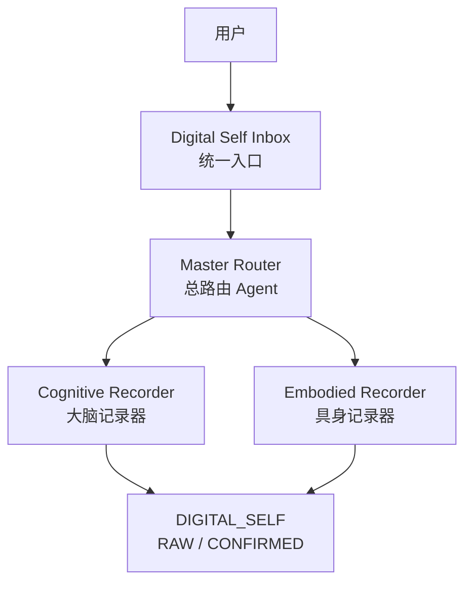

[English](README.md) | 简体中文

# SOAI

> **今天先把真实留下，未来再让更好的智能理解它。**  
> Preserve the truth today, so better intelligence can understand it tomorrow.

SOAI 是一个开源的 **Digital Self Agent（数字自我 Agent）**，目标是为未来更强大的人工智能保存高质量、长期、可重新解释的个人数据。

SOAI 的长期愿景，是逐渐走向一种类似 **JARVIS（贾维斯）** 的个人人工智能：

它能够长期理解一个人，记住重要的上下文，理解这个人的经历与变化，辅助推理、判断与决策，并最终形成高度个性化、长期持续存在的智能系统。

但是，SOAI 从一个更加克制的判断开始：

> **现在还不是制造真正“贾维斯”的时候。**

今天的 AI 模型、分析能力、心理学、行为科学，以及长期个人数据系统，都仍然处在快速发展的过程中。

因此，SOAI 在现阶段最重要的任务，并不是急着对一个人做出最终解释。

而是确保：

> **一个人的原始生命证据，不会因为今天 AI 的能力限制，而被遗失、覆盖、过早解释或永久扭曲。**

---

# 为什么需要 SOAI

未来真正强大的个人 AI，很可能需要几年、几十年，甚至更长时间积累的高质量个人数据。

这些数据可能包括：

- 对话
- 思想
- 决策
- 记忆
- 人际关系
- 项目
- 偏好
- 分歧
- 不确定性
- 矛盾
- 身体与健康信息
- 不同人生阶段发生的变化

问题在于：

今天的 AI 已经能够帮助我们记录这些东西，但并不代表今天的 AI 已经能够可靠地解释这些东西。

如果今天的 AI 对一个人做出了一个过早的判断，并且这个判断被直接保存成了“事实”，那么未来更强大的 AI 所继承的，就可能已经是一个被污染、被压缩甚至被错误解释过的人。

因此，SOAI 会把两个完全不同的任务明确分开：

```text
记录
保存真正发生过什么

        ↓

分析
解释这些证据可能意味着什么
```

第一件事应该尽可能保守。

第二件事则可以不断升级。

---

# 《钢铁侠》的类比

理解 SOAI 的一种方式，是借用《钢铁侠》中的一个故事作为类比。

在《钢铁侠 1》和《钢铁侠 2》中，Tony Stark 赖以维持生命的技术，同时也在伤害他的身体。

解决这个问题所需要的关键知识，并不是完全由 Tony 所处的时代从零发现的。

他的父亲 Howard Stark 在几十年前就已经理解了某些关键结构。

但是，由于当时的技术能力不足，他无法真正制造出对应的成果。

于是，这些关键结构以另一种形式被保留下来，隐藏在 Stark Expo 的设计之中。

几十年之后，当 Tony Stark 所处时代的技术终于足够强大时，他才能重新读取这些过去留下来的信息，并将它真正实现。

SOAI 所采用的思路与此类似。

可以把它理解成：

```text
原始的原子排列图纸
        =
高质量的原始人生语料
```

而：

```text
未来能够理解和实现这些图纸的技术
        =
未来更强的 Analysis Mode / Analysis Agent
```

关键不在于：

> 今天的系统是不是已经拥有最正确的解释。

真正关键的是：

> **原始证据有没有被完整保存到未来。**

只要原始图纸还在，未来就仍然有重新理解它的可能。

而 SOAI 原版 30 条原则最重要的意义之一，就是尽量保护这些“原始图纸”。

---

# 30 条核心原则

SOAI 的核心，是一套 **30 条 Canonical Principles（核心规范 / 宪法级原则）**。

这些原则构成 SOAI 的最高层行为约束。

它们真正珍贵的地方，并不是保证今天的 SOAI 已经能够非常准确地分析一个人。

相反，它们最重要的目标，是尽量避免：

> **把 2026 年 AI 的分析能力和局限，永久写进一个人的生命档案。**

因此，这 30 条原则特别强调：

- 保留原始语料
- AI 整理后的内容不能覆盖原始材料
- 事实与 AI 推断必须分开
- 允许存在不确定性
- 允许存在矛盾
- 允许 `UNKNOWN`
- 允许 `AMBIGUOUS`
- 不为了完整而强行补全信息
- 用户没有要求分析时，不主动分析
- 不进行过早的人格定性
- 用户确认的信息与 AI 推断的信息必须区分
- 当上下文会影响理解时，应尽量保存上下文
- 分析永远不能取代原始证据
- 必须给未来留下重新解释同一批证据的空间

换句话说：

> **SOAI 必须保持认知上的谦逊。**

它不需要假装今天就可以解释一个人的所有事情。

有时候最准确的状态就是：

```text
UNKNOWN
```

有时候应该是：

```text
AMBIGUOUS
```

有时候，两份信息确实互相矛盾。

SOAI 应该能够把这些状态原样保留下来，而不是为了制造一个看起来完整的故事，强行把它们统一起来。

---

# 先记录，再分析

SOAI 的核心理念可以浓缩成一句话：

> **Record First. Analyze Later.**  
> **先记录，再分析。**

原版 30 条真正珍贵的地方，并不是它现在就能把一个人分析得多么准确。

而是：

> **它尽量避免用 2026 年的分析能力，把可能错误的解释永久写进一个人的生命档案。**

至于这些资料究竟意味着什么，可以等到未来再重新读取。

例如，当：

- AI 模型能力更强；
- 心理学、行为科学、神经科学或其他研究更加成熟；
- 用户自己想到更可信的分析方法；
- 新的推理框架出现；
- 长期实验帮助我们找到更好的 Analysis Agent；
- 多个不同模型可以真正从不同角度理解同一批证据；

我们都可以重新读取同样的 Digital Self 数据。

因此：

> **SOAI 负责“不要把未来可能需要的真东西弄丢”。**

而不是负责：

> **“今天一定要解释清楚这个人。”**

---

# 当前系统架构

SOAI 当前的概念架构，从一个统一的 Digital Self 输入入口开始。



---

# Digital Self Inbox

所有个人资料首先进入统一输入层：

```text
Digital Self Inbox
```

未来这里可能接收：

- 文字
- 语音
- 图片
- 聊天记录
- 文档
- 自我随想
- 行为记录
- 身体数据
- 环境数据
- 未来各种传感器产生的数据

Digital Self Inbox 的意义，是让一个人的数字生命资料首先拥有一个统一入口。

---

# Master Router

**Master Router（总路由 Agent）** 负责判断：

> 这条新进入的信息应该被怎样处理？

在当前架构中，信息主要可能被路由到两套记录系统：

### Cognitive Recorder

**Cognitive Recorder（大脑记录器）** 主要处理认知与信息层面的内容，例如：

- 思想
- 对话
- 想法
- 决策
- 反思
- 计划
- 记忆
- 知识
- 人际关系
- 项目

### Embodied Recorder

**Embodied Recorder（具身记录器）** 主要处理身体与现实世界交互产生的信息，例如：

- 健康
- 睡眠
- 活动
- 运动
- 身体指标
- 营养
- 环境交互
- 未来来自传感器和穿戴设备的数据

两类 Recorder 最终都会共同构成：

```text
DIGITAL_SELF
```

---

# RAW 与 CONFIRMED

SOAI 会区分不同的信息状态。

最基础的两个状态是：

```text
RAW
```

和：

```text
CONFIRMED
```

`RAW` 代表：

原始资料，或者经过极少处理、尽量保留原貌的信息。

`CONFIRMED` 代表：

经过用户确认，或者其身份、含义、上下文、归属等已经达到足够确认程度的信息。

这个区别非常重要。

因为：

> **被保存的信息，不等于被解释的信息。**

---

# Analysis 是独立的一层

SOAI 不把 Analysis 混进最基础的数据记录过程。

分析发生在保存之后。

当 Digital Self 中已经积累了 RAW / CONFIRMED 数据以后，它们可以在未来作为不同 Analysis Agent 的输入。

例如：

```text
                    DIGITAL_SELF
                   RAW / CONFIRMED
                         │
                         ▼
               原版30条保护的数据
                         │
             ┌───────────┴───────────┐
             ▼                       ▼
      Analysis Agent A        Analysis Agent B
        原版自然分析             实验分析模型
             │                       │
             ▼                       ▼
         Analysis A              Analysis B
             \                       /
              \                     /
               └──── 用户比较 ──────┘
                         │
                         ▼
                     是否认可？
                    /         \
                  不认可        认可
                    │           │
                    ▼           ▼
                  丢弃       可保存为
                            “分析结果”
```

因此，同一批 Digital Self 数据，可以被同时喂给不同 Analysis Agent。

这样 SOAI 所探索的问题就不再只是：

> “AI 怎么评价我？”

而是：

> **“面对完全相同的一批高质量人生证据，不同推理系统会得出什么不同结果？”**

---

# Analysis Agent A 与 Analysis Agent B

SOAI 当前的实验设想，是至少保留两种分析方法。

### Analysis Agent A

代表原版、相对保守或相对自然的分析方法。

它可以作为一个长期基准。

### Analysis Agent B

代表新的实验分析方法。

它可以尝试：

- 不同 Prompt
- 不同模型
- 不同推理方法
- 不同心理学框架
- 不同证据标准
- 不同分析深度
- 不同时间尺度

为了保证比较有意义：

> **Agent A 和 Agent B 应尽量读取相同的 Digital Self 原始证据。**

只有这样，我们才能真正观察：

不同 AI、不同分析框架，对同一个人的理解究竟会产生怎样的区别。

---

# 用户拥有最终决定权

SOAI 不应该让 AI 的一次分析自动变成“真相”。

分析结果首先只是：

```text
AI Interpretation
```

而不是：

```text
Fact
```

因此完整流程应该是：

```text
AI 产生分析
        ↓
用户阅读
        ↓
用户比较不同 Analysis Agent
        ↓
用户认可或不认可
```

如果用户不认可：

```text
丢弃分析结果
```

如果用户认可：

```text
可以保存为 Analysis Result
```

即使分析结果被用户认可，它仍然应该与原始资料明确区分。

必须始终保持：

```text
事实 / 原始证据
≠
AI 推断 / AI 分析
```

---

# 为什么允许矛盾存在

人类本身就不是一个完全一致的数据库。

人会改变。

记忆会改变。

环境会改变。

价值观会改变。

一个人完全可能在不同人生阶段相信不同的事情。

同一个人五年前和五年后，也可能对同一件事情有完全不同的理解。

甚至同一件事情，在不同语境下，本来就可能存在多种互相冲突的描述。

因此 SOAI 不应该默认：

> 矛盾 = 数据错误。

矛盾本身也可能是一种重要信息。

SOAI 应该允许同时存在：

```text
陈述 A
```

和：

```text
陈述 B
```

而不是立即决定必须删除其中一个。

因为未来更强大的智能，也许能够理解今天我们无法理解的：

> 这两个看似矛盾的信息为什么能够同时存在？

---

# 为什么 UNKNOWN 很重要

传统数据库经常希望所有字段都有答案。

但 SOAI 应该抵抗这种压力。

有些情况下，最准确的答案就是：

```text
UNKNOWN
```

有些情况下则应该明确标记：

```text
AMBIGUOUS
```

这不是系统失败。

相反，它是在诚实表达：

> **当前证据还不足以支持确定结论。**

错误的确定性会破坏信息。

而被正确保存的不确定性，会给未来留下空间。

---

# Future Analysis Mode

原版 Analysis Mode 不应该被视为一个永久完成的系统。

SOAI 应该允许分析能力持续演化。

未来可以不断让新的 Analysis Agent 读取同一批被保存下来的 Digital Self 数据。

例如：

```text
Digital Self Evidence
        │
        ├── Analysis Model v1
        ├── Analysis Model v2
        ├── Analysis Model v3
        └── Future Analysis Model
```

然后比较不同版本的结果。

这实际上允许我们长期探索一个非常重要的问题：

> **当一个 AI 真正拥有多年高质量人生语料以后，它究竟应该怎样使用这些资料进行推理？**

当未来某个 Analysis Agent 或 Analysis Mode 达到足够可信的程度时，就可以考虑升级原版的分析系统。

但是最关键的是：

> 不需要重新创造过去的数据。

因为过去真正发生过的东西，从一开始就已经被保存了下来。

---

# 长期愿景

SOAI 的长期目标，并不只是一个笔记系统。

它试图探索：

> **一个长期存在、真正属于某个人的人工智能，需要什么样的基础设施？**

未来的 SOAI 可能逐渐把：

```text
Memory
+
Context
+
长期个人语料
+
具身数据
+
Reasoning
+
Multiple Analysis Agents
+
Decision Support
+
Action
```

组合在一起。

最终逐渐接近真正意义上的 Personal AI。

在流行文化里，JARVIS 是这种人工智能的一种想象。

SOAI 并不声称：

> “我们现在已经拥有贾维斯。”

恰恰相反。

SOAI 从一个更加基础的问题开始：

> **如果未来有一天 AI 真的足够聪明，我们是否还保留着足够真实、足够长期、足够高质量的人类证据，让它真正理解我们？**

SOAI 希望这个答案最终是：

> **Yes.**

---

# 核心设计思想

SOAI 最核心的设计思想可以总结为：

> **不要让今天的智能，永久破坏明天重新理解一个人的可能性。**

保留原始资料。

保留不确定性。

保留矛盾。

把事实和解释分开。

让 Analysis 可以替换。

让原始记录永远可以重新读取。

让未来更好的智能，能够重新回到同一批证据。

---

# 当前阶段

SOAI 目前仍然是一个实验性的开源项目。

现阶段主要工作包括：

1. 建立并保存原版 30 条核心原则；
2. 设计 Digital Self 整体架构；
3. 建立高质量原始语料的记录方法；
4. 把 Recording 与 Analysis 分离；
5. 实验不同的 Analysis Agent；
6. 研究 AI 应该怎样使用长期个人语料进行推理；
7. 确保未来模型能够重新解释过去的数据，同时不破坏原始证据。

因此，SOAI 目前并不是一个已经完成的人工智能。

它更像是在建设：

> **未来更强大的个人人工智能所需要的基础设施。**

---

# Repository 结构

```text
SOAI-agent/
│
├── README.md
├── README.zh-CN.md
│
├── agent/
│   ├── CANONICAL.md
│   └── CANONICAL.zh-CN.md
│
├── prompts/
│   └── system.md
│
├── architecture/
│   ├── overview.md
│   └── ...
│
├── docs/
│   └── ...
│
└── examples/
    └── ...
```

### `agent/CANONICAL.zh-CN.md`

原版 30 条核心原则的中文权威版本。

如果原始 30 条原则本身是用中文创作的，那么中文版应作为最重要的原始规范来源。

### `agent/CANONICAL.md`

30 条核心原则的英文版本。

### `prompts/`

存放真正交给 AI 模型运行的执行指令。

### `architecture/`

存放 SOAI 的系统结构、组件关系和数据流设计。

### `docs/`

存放更加详细的设计理念、技术说明和长期讨论。

### `examples/`

存放示例输入、输出和使用方式。

---

# 项目状态

**Experimental / Early Stage**

SOAI 目前处于早期实验阶段。

架构、Prompt、Analysis Agent 和具体实现方式都可能继续变化。

但是有几个核心方向希望长期保持稳定：

> **原始证据优先。**

> **事实与分析分离。**

> **允许不确定性和矛盾存在。**

> **Analysis 可以升级，但原始证据不能被覆盖。**

> **今天先把真实保存下来，未来再让更好的智能理解它。**

---

# SOAI

## **现在保存，未来理解。**

**Preserve now. Understand better later.**
